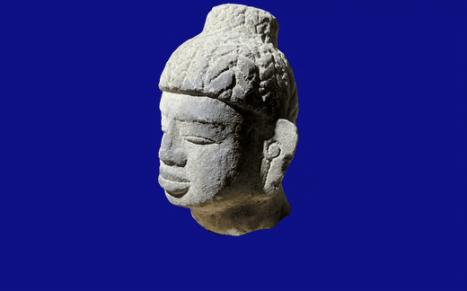

# snap3d

<p align="center">
  
  
</p>

More demo: https://teo646.github.io/snap3d-multisite/

A pipeline that turns photos of an object into a mesh + SH texture that renders directly on the web (WebGL).
It reconstructs a mesh with Gaussian-splatting-based surface reconstruction (Fast-PGSR), simplifies it to about 50k faces and unwraps its UVs.
For every texel it fits spherical-harmonics (SH) coefficients, so view-dependent color (highlights, reflections) is stored in the texture.
The result is a low-poly mesh plus two textures, so it can be rendered with shaders alone.

## Run

### 1. Prerequisites

- **Linux with an NVIDIA GPU** and a recent driver (`nvidia-smi` must work), plus `git`. Windows is untested (WSL2 with an NVIDIA GPU may work); macOS is not supported (no CUDA).
- **conda**: install [Miniconda](https://www.anaconda.com/docs/getting-started/miniconda/install).
- **Hugging Face**: the SAM3 model is gated, so you need an account.
  1. Create an account at [huggingface.co](https://huggingface.co/join).
  2. Request access on the [facebook/sam3](https://huggingface.co/facebook/sam3) page and wait for approval.
  3. Create a read-access token in the [token settings](https://huggingface.co/settings/tokens).

  The `hf` command (`huggingface_hub`) is installed into the environment by `setup.sh` in step 2.

### 2. Install

```bash
git clone --recursive https://github.com/teo646/snap3d.git
cd snap3d
./setup.sh                 # creates the conda envs snap3d and fastgs + builds the CUDA extensions (several GB to download, takes a while)
```

### 3. Log in

```bash
conda activate snap3d
hf auth login              # paste the token from step 1
```

### 4. Quick start

`data/example/statue` contains 55 photos of a statue.

```bash
python -m pipeline.orchestrator.runner \
    --config pipeline/orchestrator/configs/photo_pipeline.yaml \
    --input data/example/statue \
    --text statue \
    --run-id example_statue
```

For your own photos, pass the photo folder as `--input` and an English word describing the object as `--text`.
Results are written to `data/runs/<run_id>/`, one folder per stage.

### 5. Viewing the result

The final bundles are `data/runs/<run_id>/11_export/<run_id>_unorm8.snap3d` (small) and `..._float16.snap3d` (higher precision).
`view_bundle.py` renders using only the files in the bundle.

```bash
pip install -e ".[viewer]"   # already installed if you used setup.sh
python viewers/view_bundle.py data/runs/example_statue/11_export/example_statue_unorm8.snap3d
```

### 6. Putting it on the web

A `.snap3d` folder is exactly what [snap3d-viewer](https://github.com/teo646/snap3d-viewer) loads, with no conversion step.

1. Copy the bundle folder next to your page, e.g. `bundles/statue.snap3d`.
2. Add a canvas and the viewer script:

```html
<canvas id="canvas" style="width:100%;height:480px"></canvas>
<script src="https://teo646.github.io/snap3d-viewer/dist/viewer.js"></script>
<script>
  const viewer = new Snap3dViewer(canvas, 'bundles/statue.snap3d');
</script>
```

3. Serve the page over HTTP (any static host, such as GitHub Pages, works). Drag to orbit, wheel to zoom, WASD or the arrow keys to pan.

The viewer needs a browser with WebGL2 (Chrome 80+, Firefox 113+, Safari 16.4+).
More examples are on the demo site: https://teo646.github.io/snap3d-multisite/

## Pipeline

```
photos - SfM - masking - surface recon - hole closing - simplification - UV unwrap - baking - SLF fit - export
```

| Stage | What it does | Technology |
|---|---|---|
| ingest | Camera poses and sparse point cloud | COLMAP |
| resize_dataset | Converts to pinhole images at training resolution | |
| masking | Per-photo object mask (text prompt) | SAM3 |
| surface_recon | High-resolution mesh | Fast-PGSR (Gaussian splatting -> TSDF fusion) |
| hole_close, decimation | Closes holes and simplifies to about 50k faces | PyMeshLab |
| uv_unwrap | UV atlas | xatlas |
| baking | High-res -> low-res height map | Ray casting |
| slf | Per-texel SH coefficient fit | Conjugate gradient + normal equations |
| export | Render bundle `mesh.glb`, `sh.ktx2`, `height.ktx2` | glTF / KTX2 |

## License

The code in this repository is released under the [MIT License](LICENSE). It does not cover
`third_party/`, and the pipeline depends on components with their own terms:

- **FastGS / PGSR / Gaussian Splatting** (`third_party/FastGS`, and our changes to it in `third_party/patches/FastGS.patch`):
  non-commercial research use only, and modifications must be open source. The patch is a derivative of that code and stays under
  those licenses (see the `LICENSE.md` files in the submodule). **Running the pipeline therefore means using it for non-commercial purposes**;
  for commercial use contact the upstream authors. Please also cite the upstream projects ([FastGS](https://github.com/fastgs/FastGS), [PGSR](https://github.com/zju3dv/PGSR), [3D Gaussian Splatting](https://github.com/graphdeco-inria/gaussian-splatting)).
- **SAM 3** (`facebook/sam3`): used under Meta's [SAM License](https://huggingface.co/facebook/sam3); the model is downloaded by you and is not redistributed here.
  Acknowledge its use in any publication of results.
- **PyMeshLab** is GPL-3.0 (used in `decimation` and `hole_close`) and **pygame** is LGPL. They are installed as dependencies, not bundled; if you redistribute this code together with them, their terms apply.
- Other dependencies (COLMAP, PyTorch, Open3D, trimesh, xatlas, ...) use permissive licenses (BSD/MIT/Apache).
